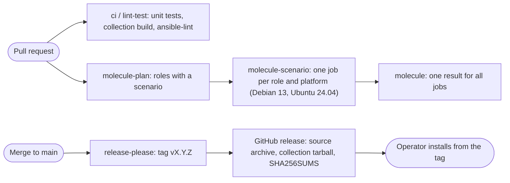

<!-- header:begin: brand-repos 0.1.0, variant studio, files in https://raw.githubusercontent.com/luminare-dev/ansible-collection-infra_edge/main/docs/brand/; the project-page sync drops this block -->
<picture>
  <source media="(prefers-color-scheme: dark)" srcset="https://raw.githubusercontent.com/luminare-dev/ansible-collection-infra_edge/main/docs/brand/readme-header-dark.svg">
  <source media="(prefers-color-scheme: light)" srcset="https://raw.githubusercontent.com/luminare-dev/ansible-collection-infra_edge/main/docs/brand/readme-header-light.svg">
  
</picture>

<!-- byline:studio -->
*a [Luminare Development](https://luminare.tech/open-source/ansible-collection-infra_edge/) open-source project*
<!-- /byline:studio -->
<!-- byline:personal
*by [ItsPaulAT](https://github.com/ItsPaulAT) · [project page](https://luminare.tech/open-source/ansible-collection-infra_edge/)*
/byline:personal -->
<!-- header:end -->

# luminare.infra_edge

Ansible collection for edge hosts: base hardening, an outbound tunnel, a web server and a database.

[](https://github.com/luminare-dev/ansible-collection-infra_edge/actions/workflows/ci.yml)
[](https://github.com/luminare-dev/ansible-collection-infra_edge/releases)
[](LICENSE)
[](https://scorecard.dev/viewer/?uri=github.com/luminare-dev/ansible-collection-infra_edge)

## Why

An edge host is a small Linux server that reaches the internet through an outbound tunnel, serves
a few sites with a web server and keeps a database next to them. Set up by hand, it needs the same
hardening and service steps every time, and the result drifts. This collection holds those steps
as Ansible roles. On every pull request, CI runs each role's Molecule scenario in Debian 13 and
Ubuntu 24.04 containers with systemd and expects `changed=0` on the second run, and each release
ships the collection tarball with checksums and build provenance.

## Quickstart

Needs Python 3.12 or later and git. Install the collection from a release tag:

<!-- x-release-please-start-version -->
```bash
python3 -m venv ~/.venvs/edge && . ~/.venvs/edge/bin/activate
pip install "ansible-core>=2.21,<2.22"
ansible-galaxy collection install git+https://github.com/luminare-dev/ansible-collection-infra_edge.git,v0.1.0
ansible-galaxy collection list luminare.infra_edge
```
<!-- x-release-please-end -->

[docs/install.md](docs/install.md) also covers the release tarball and how to verify it. Each
role's README has an example playbook, starting with
[`luminare.infra_edge.base`](roles/base/README.md#example-playbook).

## How it works

The collection holds one role per part of an edge host. Each role has its own README with the
variables (generated from its `meta/argument_specs.yml`), the controls or settings it applies
and its Molecule scenario.

| Role | What it does |
|---|---|
| [`base`](roles/base/README.md) | Hardening: unattended security upgrades, admin and automation users with SSH keys only, SSH server through `devsec.hardening.ssh_hardening` (no root login, `AllowGroups sshusers`, `MaxAuthTries 3`), default-drop nftables firewall with a drop-in directory for the other roles, fail2ban for SSH, journal limits (500 MB, 14 days), time zone, locales and host name |
| [`cloudflared`](roles/cloudflared/README.md) | Outbound tunnel: connector of a remotely managed Cloudflare Tunnel, so the host needs no open inbound port. Pinned cloudflared version installed from its package file after a SHA-256 check and held with an apt pin, tunnel token in a file that only the service user can read (never on a command line), sandboxed systemd service with its metrics listener on `127.0.0.1:2000`; takes over a connector set up with `cloudflared service install` |
| [`nginx`](roles/nginx/README.md) | Web server: nginx as the reverse proxy behind the tunnel, one site per application on a loopback listener, client address from the connector's `CF-Connecting-IP` header (trusted only from `127.0.0.1`), JSON access log, no version in the `Server` header, security headers, websockets and `nginx -t` before every reload; optional TCP and UDP relays with the stream module, whose ports go into the `base` firewall |

Every pull request runs the template checks, the unit tests (they also build and install the
collection tarball) and ansible-lint with the production profile; a unit test fails when a role
has no Molecule scenario. A plan job lists the roles with a scenario, and the matrix starts one
job per role and platform: each job tests one role in a Debian 13 or an Ubuntu 24.04 container
with systemd. An aggregate job named `molecule` reports one result for all of them. After a
merge to `main`, release-please prepares the next version; the release attaches the source
archive and the collection tarball with `SHA256SUMS`.



## Design decisions

The decisions behind this project are recorded as short ADRs in [docs/adr/](docs/adr/):

- [ADR 0001: Record architecture decisions](docs/adr/0001-record-architecture-decisions.md)
- [ADR 0002: Pin every action and downloaded tool](docs/adr/0002-pin-actions-and-downloaded-tools.md)
- [ADR 0003: Secret scanning with the gitleaks binary](docs/adr/0003-secret-scanning-with-the-gitleaks-binary.md)
- [ADR 0004: Draft releases with checksums and provenance](docs/adr/0004-draft-releases-with-checksums-and-provenance.md)
- [ADR 0005: Why git tags and release tarballs instead of a package index upload](docs/adr/0005-git-tags-and-release-tarballs.md)
- [ADR 0006: Why Molecule in systemd containers instead of virtual machines](docs/adr/0006-molecule-in-systemd-containers.md)
- [ADR 0007: Why one hash-pinned test toolchain instead of separate installs](docs/adr/0007-one-hash-pinned-test-toolchain.md)
- [ADR 0008: Why SSH hardening through devsec.hardening instead of an own sshd drop-in](docs/adr/0008-ssh-hardening-through-devsec-hardening.md)
- [ADR 0009: Why one nftables ruleset with a drop-in directory instead of a firewall per role](docs/adr/0009-nftables-ruleset-with-drop-in-directory.md)
- [ADR 0010: Why `requires_ansible` 2.20 after a passing Molecule run instead of the CI version only](docs/adr/0010-requires-ansible-after-a-passing-molecule-run.md)
- [ADR 0011: Why a pinned cloudflared package file with a checksum instead of the newest package from the repository](docs/adr/0011-pinned-cloudflared-package-file-with-checksum.md)
- [ADR 0012: Why the tunnel token in a file read by a sandboxed unit instead of `cloudflared service install`](docs/adr/0012-tunnel-token-in-a-file-read-by-a-sandboxed-unit.md)
- [ADR 0013: Why the nginx role owns nginx.conf and checks it on every run instead of a conf.d file and per-file checks](docs/adr/0013-nginx-conf-owned-by-the-role-and-checked-every-run.md)
- [ADR 0014: Why the client address comes from the loopback connector only instead of X-Forwarded-For or Cloudflare's address ranges](docs/adr/0014-client-address-from-the-loopback-connector-only.md)

## Supported versions

| Component | Tested with | Supported |
|---|---|---|
| ansible-core (control node) | 2.21.5 (CI); 2.20.10 (`base`, `cloudflared` and `nginx` scenarios, locally) | 2.20 and later (`requires_ansible: ">=2.20.0"`) |
| Python (control node) | 3.12 (Ubuntu 24.04) and 3.14 | 3.12 and later (required by ansible-core 2.20 and 2.21) |
| Collections the roles use | devsec.hardening 11.0.0, community.general 13.5.0, ansible.posix 2.2.2 | 11.x, 13.x and 2.x (`dependencies` in `galaxy.yml`) |
| Debian (managed host) | 13 "trixie" Molecule image | 13 |
| Ubuntu (managed host) | 24.04 "noble" Molecule image | 24.04 LTS |
| cloudflared (managed host) | 2026.10.2 from Cloudflare's repository (Molecule, x86-64) | 2026.10.2, pinned by the role (`cloudflared_version` with `cloudflared_deb_sha256`) |
| nginx (managed host) | 1.26.3 (Debian package `1.26.3-3+deb13u10`) and 1.24.0 (Ubuntu package `1.24.0-2ubuntu7.18`), each with its stream module (Molecule, x86-64) | the version of the distribution's package |

Fixes go into the latest minor release only. See the
[security policy](https://github.com/luminare-dev/.github/blob/main/SECURITY.md) for reporting.

## Limitations

- This version contains three roles, `base`, `cloudflared` and `nginx`. They have been applied only
  to the Debian 13 and Ubuntu 24.04 Molecule containers, not yet to a virtual machine or a cloud
  server.
- Molecule does not load the nftables ruleset into the kernel or start fail2ban (tag
  `molecule-notest`). Still to be checked on a virtual machine: `nft list ruleset` shows the drop
  policies after a reboot, a port without a drop-in is closed from another host, SSH as root and
  with a password is refused from another host (in Molecule it is refused over `127.0.0.1`), and
  fail2ban bans an address after failed logins. The opt-in `base_os_hardening_enabled` is not
  tested at all (see the [role README](roles/base/README.md#limitations)).
- No real tunnel has been connected: the `cloudflared` scenario runs the connector with a
  synthetic token in a network namespace without access to Cloudflare. Still to be checked with
  a tunnel: the connector shows as healthy with four connections, a public hostname answers, the
  start waits for the first connection and fails with a wrong token, and no listener except
  `127.0.0.1:2000` is open (see the [role README](roles/cloudflared/README.md#limitations)).
- The `nginx` scenario sends its requests with a test client that sets the connector's headers,
  not through a tunnel, and loads its firewall only in the container's own network namespace.
  Still to be checked on a virtual machine with a tunnel: the access log shows the visitors'
  addresses, and a relay port is reachable from another host while the site listeners are not
  (see the [role README](roles/nginx/README.md#limitations)).
- Cloudflare's apt index lists only the newest cloudflared version, so the role installs the
  pinned version's package file from the repository's pool; Dependabot cannot bump it
  ([ADR 0011](docs/adr/0011-pinned-cloudflared-package-file-with-checksum.md)).
- The `base` firewall flushes the whole ruleset and drops forwarded traffic, so it is not meant
  for hosts that run Docker or route traffic.
- The `molecule` check is not yet a required check of the `main` ruleset (the required checks
  are `ci / lint-test`, `secrets / gitleaks`, `pr / pr-title` and `DCO`), so a failing scenario
  shows on the pull request but does not block the merge by itself.
- Molecule runs in privileged containers, not virtual machines. Kernel-level behaviour (firewall
  rules loaded into the kernel, sysctl values, kernel modules) cannot be proven there.
- CI runs ansible-core 2.21 only; 2.20 is tested by hand: the `base`, `cloudflared` and `nginx`
  scenarios passed with 2.20.10 locally ([ADR 0010](docs/adr/0010-requires-ansible-after-a-passing-molecule-run.md)).
  Older versions are not supported.
- The Molecule jobs install `devsec.hardening` from Ansible Galaxy within its version range,
  not from a hash-pinned file like the other test tools, so a Galaxy outage fails the `molecule`
  check ([ADR 0008](docs/adr/0008-ssh-hardening-through-devsec-hardening.md)). The required
  `ci / lint-test` check runs ansible-lint with `--offline` and does not use Galaxy.
- Only x86-64 is tested (the GitHub `ubuntu-24.04` runner and the local test machine).
- `ansible-test sanity` is not run: the collection has no plugins or modules, and ansible-lint
  checks the roles and the metadata.
- The collection is not on Ansible Galaxy yet: it is installed from the git tags and the
  tarballs of the GitHub releases only, and the namespace `luminare` has not been requested yet
  ([ADR 0005](docs/adr/0005-git-tags-and-release-tarballs.md)).

## Results

| What | Value | How it was measured |
|---|---|---|
| Molecule `base`, ansible-core 2.21.5 | Debian 13 and Ubuntu 24.04: converge `changed=30` per instance, idempotence `changed=0`, verify passed (`ok=95`, `rescued=6` per instance: the checks, including SSH logins over `127.0.0.1`, and the role's input checks with 8 host names, 6 of them refused); 5 min 16 s for both platforms | `molecule test` in `roles/base` with the tools of `requirements-test.txt` (Python 3.14) and an empty home directory, local Docker, 2026-10-22 |
| Molecule `base`, ansible-core 2.20.10 | Debian 13 and Ubuntu 24.04: converge `changed=30` per instance, idempotence `changed=0`, verify passed (`ok=95`, `rescued=6` per instance); 7 min 35 s for both platforms | the same scenario in a separate virtual environment (Python 3.14) with ansible-core 2.20.10, Molecule 26.10.0, molecule-plugins 26.10.12 and the collections of the `ansible` 14.5.0 package (installed with `--no-deps`), an empty home directory, while other Molecule scenarios ran on the same Docker daemon, 2026-10-22 |
| Molecule `cloudflared`, ansible-core 2.21.5 | Debian 13 and Ubuntu 24.04: converge `changed=17` per instance, idempotence `changed=0`, verify passed (34 tasks per instance, including the token checks, the listener check in the service's network namespace and the `systemd-analyze security` rating of 1.3 for the unit file); 2 min 35 s for both platforms | `molecule test` in `roles/cloudflared` with the tools of `requirements-test.txt` (Python 3.14) and an empty home directory, local Docker, cloudflared 2026.10.2 from `pkg.cloudflare.com`, connector without network access, 2026-10-21 |
| Molecule `cloudflared`, ansible-core 2.20.10 | the same counts; 2 min 27 s for both platforms | the same scenario in the ansible-core 2.20.10 environment of the `base` row above, 2026-10-21 |
| Tunnel token in test output | 0 occurrences of the synthetic token and of its secret | searched the complete output of both `cloudflared` runs above and of a converge with `-vvv`, 2026-10-21 |
| Molecule `nginx`, ansible-core 2.21.5 | Debian 13 and Ubuntu 24.04: converge `changed=11` per instance, idempotence `changed=0`, verify passed (32 tasks per instance: requests through both sites, the websocket and the TCP and UDP relay, the JSON logs, the listeners and the loaded firewall rules), then the removal of a site and of the relay (side effect `changed=5`, 10 checks passed); 5 min 5 s for both platforms | `molecule test` in `roles/nginx` with the tools of `requirements-test.txt` (Python 3.14) and an empty home directory, local Docker, nginx from the distributions' mirrors, 2026-10-21 |
| Molecule `nginx`, ansible-core 2.20.10 | the same counts; 5 min 0 s for both platforms | the same scenario in the ansible-core 2.20.10 environment of the `base` row above, 2026-10-21 |
| Unit tests | 135 run: 133 passed, 2 skipped (markdownlint-cli2 not on the PATH; a template-only check) | `python3 -m unittest discover -s tests -v` with Python 3.14, 2026-10-21 |
| ansible-lint | 0 failures, 0 warnings in 88 files, production profile | `ansible-lint --offline` 26.10.1 in a fresh clone of the repository with an empty home directory (nothing downloaded from Galaxy), 2026-10-22 |
| Collection tarball | 76 files, about 77 KB; installs into an empty collections path | `ansible-galaxy collection build`, then `ansible-galaxy collection install --no-deps` (ansible-core 2.21.5), 2026-10-22 |
| Test tools install | 47 packages in 51 s, every file checked against its sha256 | `pip install --require-hashes --only-binary=:all:` of `requirements-dev.txt` and `requirements-test.txt` with Python 3.12 in an `ubuntu:24.04` container, 2026-10-21 |

## Documentation and links

- [Installation](docs/install.md) · [Configuration](docs/configuration.md) ·
  [Upgrade](docs/upgrade.md) · [Troubleshooting](docs/troubleshooting.md) ·
  [Runbook](docs/runbook.md) · [ADRs](docs/adr/) · [Roles](roles/README.md)
- [Changelog](CHANGELOG.md) and [releases](https://github.com/luminare-dev/ansible-collection-infra_edge/releases)
  (each release has `SHA256SUMS` and a build provenance attestation)
- [Contributing](https://github.com/luminare-dev/.github/blob/main/CONTRIBUTING.md) ·
  [Code of conduct](https://github.com/luminare-dev/.github/blob/main/CODE_OF_CONDUCT.md) ·
  [Security](https://github.com/luminare-dev/.github/blob/main/SECURITY.md) ·
  [Support](https://github.com/luminare-dev/.github/blob/main/SUPPORT.md)
- Project page: <https://luminare.tech/open-source/ansible-collection-infra_edge/>

## Licence

[Apache-2.0](LICENSE). The licence covers the code only: the project name, logo, header images
and `docs/brand/` are not licensed (see [NOTICE](NOTICE)).

<!-- byline:studio -->
*a [Luminare Development](https://luminare.tech/open-source/ansible-collection-infra_edge/) open-source project*
<!-- /byline:studio -->
<!-- byline:personal
*by [ItsPaulAT](https://github.com/ItsPaulAT) · [project page](https://luminare.tech/open-source/ansible-collection-infra_edge/)*
/byline:personal -->
