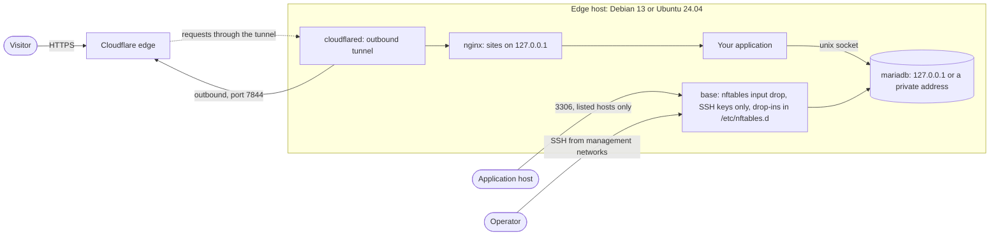

<!-- header:begin: brand-repos 0.1.0, variant studio, files in https://raw.githubusercontent.com/luminare-dev/ansible-collection-infra_edge/main/docs/brand/; the project-page sync drops this block -->
<picture>
  <source media="(prefers-color-scheme: dark)" srcset="https://raw.githubusercontent.com/luminare-dev/ansible-collection-infra_edge/main/docs/brand/readme-header-dark.svg">
  <source media="(prefers-color-scheme: light)" srcset="https://raw.githubusercontent.com/luminare-dev/ansible-collection-infra_edge/main/docs/brand/readme-header-light.svg">
  
</picture>

<!-- byline:studio -->
*a [Luminare Development](https://luminare.tech/open-source/ansible-collection-infra_edge/) open-source project*
<!-- /byline:studio -->
<!-- byline:personal
*by [ItsPaulAT](https://github.com/ItsPaulAT) · [project page](https://luminare.tech/open-source/ansible-collection-infra_edge/)*
/byline:personal -->
<!-- header:end -->

# luminare.infra_edge

Ansible collection for edge hosts: base hardening, an outbound tunnel, a web server and a database.

[](https://github.com/luminare-dev/ansible-collection-infra_edge/actions/workflows/ci.yml)
[](https://github.com/luminare-dev/ansible-collection-infra_edge/releases)
[](LICENSE)
[](https://scorecard.dev/viewer/?uri=github.com/luminare-dev/ansible-collection-infra_edge)

## Why

A small edge server usually needs the same few parts: SSH with keys only and a firewall that
drops everything else, an outbound tunnel so that no web port has to be open, a reverse proxy for
the sites and a database next to them. Put together by hand or from unrelated roles, the parts
are easy to combine wrongly, for example a database on every address, a proxy that trusts any
forwarded client address, or a firewall rule that stays after its service is gone. This
collection provides the four parts as roles that share one firewall layout, in which each role
opens only its own port, and keep the sites and by default the database on the loopback
interface, plus the playbook `luminare.infra_edge.edge` that sets up a whole host with them. Every pull request tests each
role and the playbook with Molecule on Debian 13 and Ubuntu 24.04, including a second run that
must report `changed=0`.

### Why not another role?

The projects below are more widely used and cover more systems and options. This collection is
narrower on purpose: one host layout on two distributions, with parts that are built and tested
to work together.

| Project | What it does | How this collection differs |
|---|---|---|
| [papanito/ansible-role-cloudflared](https://github.com/papanito/ansible-role-cloudflared) | Installs cloudflared (by default the latest GitHub release, optionally from Cloudflare's apt repository), writes one configuration file per tunnel with its ingress rules and credentials or token, can create DNS, network and load balancer routes, runs each tunnel as an instance of a systemd template unit (as root unless another user is set) or as a SysV service, and can write SSH client settings for Cloudflare Access | `cloudflared` runs only the connector of a remotely managed tunnel: ingress rules and routes stay in the Cloudflare dashboard or API, one pinned version is installed from a package file with a checked SHA-256, and the service runs as its own user in a sandboxed unit that reads the token from a file |
| [devsec.hardening](https://github.com/dev-sec/ansible-collection-hardening) | Hardens an existing system and existing services along the DevSec baselines on many distributions: `os_hardening` (kernel parameters, PAM, login settings, file permissions and more), `ssh_hardening`, `nginx_hardening` and `mysql_hardening` | `base` uses `devsec.hardening.ssh_hardening` for the SSH server ([ADR 0008](docs/adr/0008-ssh-hardening-through-devsec-hardening.md)) and offers `os_hardening` as an opt-in. The collection also does what devsec.hardening leaves to other roles: the firewall, the tunnel connector, and installing nginx and MariaDB with their sites, databases and dumps |
| geerlingguy roles: [security](https://github.com/geerlingguy/ansible-role-security), [firewall](https://github.com/geerlingguy/ansible-role-firewall), [nginx](https://github.com/geerlingguy/ansible-role-nginx), [mysql](https://github.com/geerlingguy/ansible-role-mysql) | General-purpose roles for many distributions that can be combined freely: SSH settings, fail2ban, sudo rules and automatic updates; an iptables firewall with its own service; nginx with virtual hosts; MySQL or MariaDB with a root password, the secure-installation steps, databases, users and replication | The four roles here are built for each other: nftables with one drop-in folder that the other roles write their ports to, sites only on loopback listeners behind the tunnel, MariaDB root on `unix_socket` login without a stored password plus nightly dumps, and a Molecule scenario that tests the combination |

## Quickstart

Needs Python 3.12 or later and git on the control node, and a Debian 13 or Ubuntu 24.04 host with
sudo that you reach over SSH as root. Install the collection from a release tag and copy its
example inventory; before the last two commands, put your host, SSH keys, management networks,
site and database into `edge/inventory.yml` and `edge/group_vars/edge/main.yml` (see
[the example's README](examples/edge/README.md)):

<!-- x-release-please-start-version -->
```bash
python3 -m venv ~/.venvs/edge && . ~/.venvs/edge/bin/activate && pip install "ansible-core>=2.21,<2.22"
ansible-galaxy collection install git+https://github.com/luminare-dev/ansible-collection-infra_edge.git,v0.1.0
cp -r ~/.ansible/collections/ansible_collections/luminare/infra_edge/examples/edge edge
ansible-vault create edge/group_vars/edge/vault.yml   # the three vault_* values of the example
read -rs TUNNEL_TOKEN && export TUNNEL_TOKEN && ansible-playbook -i edge/inventory.yml luminare.infra_edge.edge --ask-vault-pass
```
<!-- x-release-please-end -->

[docs/install.md](docs/install.md) also covers the release tarball and how to verify it. Each
role can also be used alone; its README has an example playbook, starting with
[`luminare.infra_edge.base`](roles/base/README.md#example-playbook).

## How it works

The playbook [`luminare.infra_edge.edge`](playbooks/edge.yml) runs the four roles in the order of
the table below on the hosts of the group `edge`, with every value from the inventory. Visitors reach the host
only through the tunnel: the connector keeps an outbound connection to Cloudflare's edge and
passes each request to an nginx site on `127.0.0.1`, which forwards it to the application. The
database listens on `127.0.0.1` or a private address, and the firewall of `base` drops every
packet to a port that no role opened.



| Role | What it does |
|---|---|
| [`base`](roles/base/README.md) | Hardening: unattended security upgrades, admin and automation users with SSH keys only, SSH server through `devsec.hardening.ssh_hardening` (no root login, `AllowGroups sshusers`, `MaxAuthTries 3`), default-drop nftables firewall with a drop-in directory for the other roles, fail2ban for SSH, journal limits (500 MB, 14 days), time zone, locales and host name |
| [`cloudflared`](roles/cloudflared/README.md) | Outbound tunnel: connector of a remotely managed Cloudflare Tunnel, so the host needs no open inbound port. Pinned cloudflared version installed from its package file after a SHA-256 check and held with an apt pin, tunnel token in a file that only the service user can read (never on a command line), sandboxed systemd service with its metrics listener on `127.0.0.1:2000`; takes over a connector set up with `cloudflared service install` |
| [`nginx`](roles/nginx/README.md) | Web server: nginx as the reverse proxy behind the tunnel, one site per application on a loopback listener, client address from the connector's `CF-Connecting-IP` header (trusted only from `127.0.0.1`), JSON access log, no version in the `Server` header, security headers, websockets and `nginx -t` before every reload; optional TCP and UDP relays with the stream module, whose ports go into the `base` firewall |
| [`mariadb`](roles/mariadb/README.md) | Database: MariaDB from the distribution on `127.0.0.1` by default, root with `unix_socket` login and no password, anonymous accounts, the test database and remote root accounts removed, one tuning file (character set, InnoDB sizes, connections, slow query log), databases and accounts from a list through `ansible.mariadb` (passwords never in the output), nightly zstd dumps per database plus the accounts with a two-day retention by a sandboxed systemd timer; optional port 3306 for application hosts in the `base` firewall |

The example inventory in [`examples/edge/`](examples/edge/) is the one that CI tests: the Molecule
scenario `edge` runs the playbook with its `group_vars` on Debian 13 and Ubuntu 24.04 (with test
values only for what the example leaves to the operator or what a container needs, listed in
[its README](examples/edge/README.md)), loads the composed firewall and connects from other
addresses (an application host, a management host and another host) to see what it lets
through, then sends a request through nginx to a test application that reads its database over
the socket.

Every pull request runs the template checks, the unit tests (they also build and install the
collection tarball and check the example inventory against the variables of the roles) and
ansible-lint with the production profile. The Molecule jobs test each role in its own scenario,
one job per role and platform, and the playbook in the `edge` scenario, one job per platform; an
aggregate job named `molecule` reports one result for all of them. After a merge to `main`,
release-please prepares the next version; the release attaches the source archive and the
collection tarball with `SHA256SUMS`.

## Design decisions

The decisions behind this project are recorded as short ADRs in [docs/adr/](docs/adr/):

- [ADR 0001: Record architecture decisions](docs/adr/0001-record-architecture-decisions.md)
- [ADR 0002: Pin every action and downloaded tool](docs/adr/0002-pin-actions-and-downloaded-tools.md)
- [ADR 0003: Secret scanning with the gitleaks binary](docs/adr/0003-secret-scanning-with-the-gitleaks-binary.md)
- [ADR 0004: Draft releases with checksums and provenance](docs/adr/0004-draft-releases-with-checksums-and-provenance.md)
- [ADR 0005: Why git tags and release tarballs instead of a package index upload](docs/adr/0005-git-tags-and-release-tarballs.md)
- [ADR 0006: Why Molecule in systemd containers instead of virtual machines](docs/adr/0006-molecule-in-systemd-containers.md)
- [ADR 0007: Why one hash-pinned test toolchain instead of separate installs](docs/adr/0007-one-hash-pinned-test-toolchain.md)
- [ADR 0008: Why SSH hardening through devsec.hardening instead of an own sshd drop-in](docs/adr/0008-ssh-hardening-through-devsec-hardening.md)
- [ADR 0009: Why one nftables ruleset with a drop-in directory instead of a firewall per role](docs/adr/0009-nftables-ruleset-with-drop-in-directory.md)
- [ADR 0010: Why `requires_ansible` 2.20 after a passing Molecule run instead of the CI version only](docs/adr/0010-requires-ansible-after-a-passing-molecule-run.md)
- [ADR 0011: Why a pinned cloudflared package file with a checksum instead of the newest package from the repository](docs/adr/0011-pinned-cloudflared-package-file-with-checksum.md)
- [ADR 0012: Why the tunnel token in a file read by a sandboxed unit instead of `cloudflared service install`](docs/adr/0012-tunnel-token-in-a-file-read-by-a-sandboxed-unit.md)
- [ADR 0013: Why the nginx role owns nginx.conf and checks it on every run instead of a conf.d file and per-file checks](docs/adr/0013-nginx-conf-owned-by-the-role-and-checked-every-run.md)
- [ADR 0014: Why the client address comes from the loopback connector only instead of X-Forwarded-For or Cloudflare's address ranges](docs/adr/0014-client-address-from-the-loopback-connector-only.md)
- [ADR 0015: Why ansible.mariadb for the database role instead of community.mysql or own SQL tasks](docs/adr/0015-ansible-mariadb-collection-for-the-database-role.md)
- [ADR 0016: Why logical dumps per database with a systemd timer instead of physical backups or cron](docs/adr/0016-logical-dumps-per-database-with-a-systemd-timer.md)
- [ADR 0017: Why a collection playbook with a tested example inventory instead of an all-in-one role](docs/adr/0017-edge-playbook-with-example-inventory.md)

## Supported versions

| Component | Tested with | Supported |
|---|---|---|
| ansible-core (control node) | 2.21.5 (CI); 2.20.10 (every Molecule scenario, locally) | 2.20 and later (`requires_ansible: ">=2.20.0"`) |
| Python (control node) | 3.12 (Ubuntu 24.04) and 3.14 | 3.12 and later (required by ansible-core 2.20 and 2.21) |
| Collections the roles use | devsec.hardening 11.0.0, community.general 13.5.0, ansible.posix 2.2.2, ansible.mariadb 6.0.2 | 11.x, 13.x, 2.x and 6.x (`dependencies` in `galaxy.yml`) |
| Debian (managed host) | 13 "trixie" Molecule image | 13 |
| Ubuntu (managed host) | 24.04 "noble" Molecule image | 24.04 LTS |
| cloudflared (managed host) | 2026.10.2 from Cloudflare's repository (Molecule, x86-64) | 2026.10.2, pinned by the role (`cloudflared_version` with `cloudflared_deb_sha256`) |
| nginx (managed host) | 1.26.3 (Debian package `1.26.3-3+deb13u10`) and 1.24.0 (Ubuntu package `1.24.0-2ubuntu7.18`), each with its stream module (Molecule, x86-64) | the version of the distribution's package |
| MariaDB (managed host) | 11.8.6 (Debian package `1:11.8.6-0+deb13u1`) and 10.11.14 (Ubuntu package `1:10.11.14-0ubuntu0.24.04.1`), with PyMySQL 1.1.1 and 1.0.2 from the distributions (Molecule, x86-64) | the version of the distribution's package |

Operating systems of the managed hosts, as tested by the Molecule scenarios (x86-64 containers
with systemd; each cell: converge, a second run with `changed=0` and verify passed with
ansible-core 2.21.5 and 2.20.10):

| Managed host | `base` | `cloudflared` | `nginx` | `mariadb` | playbook `edge` |
|---|---|---|---|---|---|
| Debian 13 "trixie" | passed | passed | passed | passed | passed |
| Ubuntu 24.04 "noble" | passed | passed | passed | passed | passed |

Fixes go into the latest minor release only. See the
[security policy](https://github.com/luminare-dev/.github/blob/main/SECURITY.md) for reporting.

## Limitations

- This version contains four roles, `base`, `cloudflared`, `nginx` and `mariadb`, and the
  playbook `edge`. They have been applied only to Debian 13 and Ubuntu 24.04 Molecule containers,
  not yet to a virtual machine or a cloud server. A first run of the playbook on a fresh cloud
  image (login as root, then the switch to the automation user) has not been tried.
- The role scenario of `base` does not load the nftables ruleset or start fail2ban (tag
  `molecule-notest`). The `edge` scenario does both, inside the container's own network
  namespace, and connects from addresses in a second namespace: SSH from the management network
  and port 3306 from the application host get through, everything else is dropped. Still to be
  checked on a virtual machine: the ruleset after a reboot and on the real interfaces from another
  machine, SSH as root and with a password refused from another machine (in Molecule it is refused
  over `127.0.0.1`), and fail2ban banning an address after failed logins (the `edge` scenario
  checks only that the jail runs: SSH is open only to the management networks, which fail2ban
  never bans). The opt-in `base_os_hardening_enabled` is not tested at all (see the
  [role README](roles/base/README.md#limitations)).
- No real tunnel has been connected: the `cloudflared` and `edge` scenarios run the connector with
  a synthetic token in a network namespace without access to Cloudflare. Still to be checked with
  a tunnel: the connector shows as healthy with four connections, a public hostname answers
  through nginx, the start waits for the first connection and fails with a wrong token, and no
  listener except `127.0.0.1:2000` is open (see the
  [role README](roles/cloudflared/README.md#limitations)).
- The `nginx` and `edge` scenarios send their requests with a test client that sets the
  connector's headers, not through a tunnel. Still to be checked on a virtual machine with a
  tunnel: the access log shows the visitors' addresses, and a relay port is reachable from another
  host while the site listeners are not (see the [role README](roles/nginx/README.md#limitations)).
- The `mariadb` scenario reaches the server from inside its own container, the `edge` scenario
  from a second network namespace in the same container. Still to be checked on virtual machines:
  an application host on another machine reaches port 3306 through the firewall and another host
  does not, and a nightly run of the timer (the scenario starts the dump service directly). The
  connections to the database are not encrypted, and the dumps stay on the host until a backup
  tool copies them (see the [role README](roles/mariadb/README.md#limitations)).
- Check mode (`--check`) is tested only for the `mariadb` role, not for the other roles or the
  playbook.
- The playbook has no switches per role: `--skip-tags <role>` leaves a role out, and a host that
  needs a different combination uses its own playbook with the roles.
- Cloudflare's apt index lists only the newest cloudflared version, so the role installs the
  pinned version's package file from the repository's pool; Dependabot cannot bump it
  ([ADR 0011](docs/adr/0011-pinned-cloudflared-package-file-with-checksum.md)).
- The `base` firewall flushes the whole ruleset and drops forwarded traffic, so it is not meant
  for hosts that run Docker or route traffic.
- The `molecule` check is not yet a required check of the `main` ruleset (the required checks
  are `ci / lint-test`, `secrets / gitleaks`, `pr / pr-title` and `DCO`), so a failing scenario
  shows on the pull request but does not block the merge by itself.
- Molecule runs in privileged containers, not virtual machines. Kernel-level behaviour on the
  host's real interfaces, sysctl values and kernel modules cannot be proven there.
- CI runs ansible-core 2.21 only; 2.20 is tested by hand: every Molecule scenario passed with
  2.20.10 locally ([ADR 0010](docs/adr/0010-requires-ansible-after-a-passing-molecule-run.md)).
  Older versions are not supported.
- The Molecule jobs install `devsec.hardening` from Ansible Galaxy within its version range,
  not from a hash-pinned file like the other test tools, so a Galaxy outage fails the `molecule`
  check ([ADR 0008](docs/adr/0008-ssh-hardening-through-devsec-hardening.md)). The required
  `ci / lint-test` check runs ansible-lint with `--offline` and does not use Galaxy.
- Only x86-64 is tested (the GitHub `ubuntu-24.04` runner and the local test machine).
- `ansible-test sanity` is not run: the collection has no plugins or modules, and ansible-lint
  checks the roles, the playbook and the metadata.
- The collection is not on Ansible Galaxy yet: it is installed from the git tags and the
  tarballs of the GitHub releases only, and the namespace `luminare` has not been requested yet
  ([ADR 0005](docs/adr/0005-git-tags-and-release-tarballs.md)).

## Results

| What | Value | How it was measured |
|---|---|---|
| Molecule `base`, ansible-core 2.21.5 | Debian 13 and Ubuntu 24.04: converge `changed=30` per instance, idempotence `changed=0`, verify passed (`ok=95`, `rescued=6` per instance: the checks, including SSH logins over `127.0.0.1`, and the role's input checks with 8 host names, 6 of them refused); 5 min 16 s for both platforms | `molecule test` in `roles/base` with the tools of `requirements-test.txt` (Python 3.14) and an empty home directory, local Docker, 2026-10-22 |
| Molecule `base`, ansible-core 2.20.10 | Debian 13 and Ubuntu 24.04: converge `changed=30` per instance, idempotence `changed=0`, verify passed (`ok=95`, `rescued=6` per instance); 7 min 35 s for both platforms | the same scenario in a separate virtual environment (Python 3.14) with ansible-core 2.20.10, Molecule 26.10.0, molecule-plugins 26.10.12 and the collections of the `ansible` 14.5.0 package (installed with `--no-deps`), an empty home directory, while other Molecule scenarios ran on the same Docker daemon, 2026-10-22 |
| Molecule `cloudflared`, ansible-core 2.21.5 | Debian 13 and Ubuntu 24.04: converge `changed=17` per instance, idempotence `changed=0`, verify passed (34 tasks per instance, including the token checks, the listener check in the service's network namespace and the `systemd-analyze security` rating of 1.3 for the unit file); 2 min 35 s for both platforms | `molecule test` in `roles/cloudflared` with the tools of `requirements-test.txt` (Python 3.14) and an empty home directory, local Docker, cloudflared 2026.10.2 from `pkg.cloudflare.com`, connector without network access, 2026-10-21 |
| Molecule `cloudflared`, ansible-core 2.20.10 | the same counts; 2 min 27 s for both platforms | the same scenario in the ansible-core 2.20.10 environment of the `base` row above, 2026-10-21 |
| Tunnel token in test output | 0 occurrences of the synthetic token and of its secret | searched the complete output of both `cloudflared` runs above and of a converge with `-vvv`, 2026-10-21 |
| Molecule `nginx`, ansible-core 2.21.5 | Debian 13 and Ubuntu 24.04: converge `changed=11` per instance, idempotence `changed=0`, verify passed (32 tasks per instance: requests through both sites, the websocket and the TCP and UDP relay, the JSON logs, the listeners and the loaded firewall rules), then the removal of a site and of the relay (side effect `changed=5`, 10 checks passed); 5 min 5 s for both platforms | `molecule test` in `roles/nginx` with the tools of `requirements-test.txt` (Python 3.14) and an empty home directory, local Docker, nginx from the distributions' mirrors, 2026-10-21 |
| Molecule `nginx`, ansible-core 2.20.10 | the same counts; 5 min 0 s for both platforms | the same scenario in the ansible-core 2.20.10 environment of the `base` row above, 2026-10-21 |
| Molecule `mariadb`, ansible-core 2.21.5 | Debian 13 and Ubuntu 24.04: converge `changed=12` per instance, idempotence `changed=0`, verify passed (46 tasks per instance: the settings, accounts, listener, slow query log, a run of the dump service with its retention, and the restore of a database and of the accounts from the dumps), then the planted insecure accounts and the setup for application hosts (side effect `changed=12`, then 15 tasks of `verify_app_hosts.yml` passed per instance, including the loaded firewall rules); 4 min 53 s for both platforms | `molecule test` in `roles/mariadb` with the tools of `requirements-test.txt` (Python 3.14) and an empty home directory, local Docker, MariaDB from the distributions' mirrors, 2026-10-22 |
| Molecule `mariadb`, ansible-core 2.20.10 | the same counts; 5 min 50 s for both platforms | the same scenario in the ansible-core 2.20.10 environment of the `base` row above (rebuilt the same way), 2026-10-22 |
| Molecule `edge` (the playbook with the example inventory), ansible-core 2.21.5 | Debian 13 and Ubuntu 24.04: converge `changed=71` per instance (all four roles), idempotence `changed=0` for the four roles together, verify passed (24 tasks per instance: the loaded firewall with the drop-in of `mariadb`, the DHCPv6 rule and fail2ban, six connections from three other addresses through the firewall, an SSH login from the management network and a database login from the application host, the listeners of the whole host, a request through nginx to a test application that reads its database over the socket, and the connector); 10 min 39 s for both platforms | `molecule test --scenario-name edge` from the repository root with the tools of `requirements-test.txt` (Python 3.14) and an empty home directory, local Docker, while other Molecule scenarios ran on the same Docker daemon, 2026-10-22 |
| Molecule `edge`, ansible-core 2.20.10 | the same counts; 9 min 37 s for both platforms | the same scenario in the ansible-core 2.20.10 environment of the `base` row above (rebuilt the same way), while other Molecule scenarios ran on the same Docker daemon, 2026-10-22 |
| Secrets in the `edge` output | 0 occurrences of the synthetic token, its secret, the two database passwords and the admin password hash | searched the complete output of the ansible-core 2.21.5 run of `edge`, 2026-10-22 |
| Checks in the verify playbooks | `base` 43 tasks with 13 assertions (60 conditions); `cloudflared` 34 tasks with 14 assertions (61 conditions); `nginx` 42 tasks with 21 assertions (97 conditions); `mariadb` 60 tasks with 21 assertions (84 conditions); `edge` 24 tasks with 9 assertions (30 conditions). An assertion in a loop runs once per item | counted with a short script over the `verify*.yml` files of each scenario (tasks, `ansible.builtin.assert` tasks and the conditions in their `that` lists), 2026-10-22 |
| Passwords in test output | 0 occurrences of the account password and of its hash | searched the complete output of a `mariadb` converge with `-vvv`, 2026-10-22 |
| Check mode, `mariadb` | 0 failures: a host without MariaDB reports only the package installation (`changed=1`), a host with the packages but without the role reports the changes the role would make, and a converged host `changed=0` | `molecule converge -- --check` on the scenario's instances in these three states, 2026-10-22 |
| Unit tests | 154 run: 152 passed, 2 skipped (markdownlint-cli2 not on the PATH; a template-only check); they include a run of the `mariadb` dump script with stand-ins for the MariaDB tools and the checks of the playbook and its example inventory against the roles' variables | `python3 -m unittest discover -s tests -v` with Python 3.14, 2026-10-22 |
| ansible-lint | 0 failures, 0 warnings in 125 files, production profile | `ansible-lint --offline` 26.10.1 in a fresh clone of the repository with an empty home directory, after `ansible-galaxy collection install --no-deps --force .` as in CI (nothing downloaded from Galaxy), 2026-10-22 |
| Collection tarball | 102 files, about 109 KB; installs into an empty collections path | `ansible-galaxy collection build`, then `ansible-galaxy collection install --no-deps` (ansible-core 2.21.5), 2026-10-22 |
| Test tools install | 47 packages in 51 s, every file checked against its sha256 | `pip install --require-hashes --only-binary=:all:` of `requirements-dev.txt` and `requirements-test.txt` with Python 3.12 in an `ubuntu:24.04` container, 2026-10-21 |

## Documentation and links

- [Installation](docs/install.md) · [Configuration](docs/configuration.md) ·
  [Upgrade](docs/upgrade.md) · [Troubleshooting](docs/troubleshooting.md) ·
  [Runbook](docs/runbook.md) · [ADRs](docs/adr/) · [Roles](roles/README.md) ·
  [Edge playbook](playbooks/edge.yml) with its [example inventory](examples/edge/README.md)
- [Changelog](CHANGELOG.md) and [releases](https://github.com/luminare-dev/ansible-collection-infra_edge/releases)
  (each release has `SHA256SUMS` and a build provenance attestation)
- [Contributing](https://github.com/luminare-dev/.github/blob/main/CONTRIBUTING.md) ·
  [Code of conduct](https://github.com/luminare-dev/.github/blob/main/CODE_OF_CONDUCT.md) ·
  [Security](https://github.com/luminare-dev/.github/blob/main/SECURITY.md) ·
  [Support](https://github.com/luminare-dev/.github/blob/main/SUPPORT.md)
- Project page: <https://luminare.tech/open-source/ansible-collection-infra_edge/>

## Licence

[Apache-2.0](LICENSE). The licence covers the code only: the project name, logo, header images
and `docs/brand/` are not licensed (see [NOTICE](NOTICE)).

<!-- byline:studio -->
*a [Luminare Development](https://luminare.tech/open-source/ansible-collection-infra_edge/) open-source project*
<!-- /byline:studio -->
<!-- byline:personal
*by [ItsPaulAT](https://github.com/ItsPaulAT) · [project page](https://luminare.tech/open-source/ansible-collection-infra_edge/)*
/byline:personal -->
